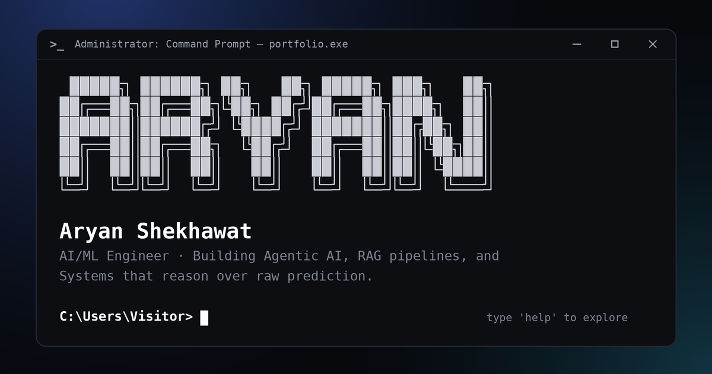

# Aryan Shekhawat · Terminal Portfolio

An interactive portfolio that behaves like a command prompt. Visitors type commands (or click the highlighted ones) to explore my projects, research, experience and skills.

**Live:** https://aryan07-portfolio.vercel.app



## Try these commands

| Command | What it shows |
|---|---|
| `about` | Who I am and what I care about |
| `projects` / `projects 1` | Things I've built, with details and links |
| `open <project>` | Opens a project's live demo (e.g. `open codeatlas`) |
| `experience` | DRDO AI/ML internship |
| `research` | Papers and ongoing work |
| `skills` | Languages, frameworks, tools |
| `education`, `achievements`, `certifications` | Grades, hackathons, courses |
| `resume` | Opens my résumé (PDF) |
| `tour` | A guided walkthrough, press Enter for each stop |
| `neofetch`, `contact`, `help`, `clear` | Quick summary, links, command list |

Shortcuts: `Tab` autocompletes, `↑ ↓` recalls history, `Ctrl+L` clears. The sun/moon button switches light and dark mode.

## How it's built

- A single static `index.html` with plain HTML, CSS and JavaScript. No framework, no build step, no backend, no API keys.
- Live weather in the status bar comes from the free [Open-Meteo](https://open-meteo.com) API.
- Hosted on Vercel and redeployed automatically on every push to `main`.
- The browser remembers two things locally (`localStorage`): whether you've visited before and your light/dark choice. Nothing is sent to a server.

## Project structure

```
aryan-portfolio/
├── index.html     # the whole site
├── og-image.png   # link preview card used when the URL is shared
├── README.md
└── resume.pdf     # served by the `resume` command
```

## Run locally

Open `index.html` in a browser. That's it.

## Customize

Content lives near the top of the script in `index.html`: contact links in `ME`, projects in `PROJ`, and each command's text in `CMDS`.

To update the résumé, replace `resume.pdf` with the new file (keep the exact name) and bump the version in `resumeURL` (for example `resume.pdf?v=2`) so browsers don't show a cached copy.

## Contact

[aryanshekhawat1947@gmail.com](mailto:aryanshekhawat1947@gmail.com) · [LinkedIn](https://www.linkedin.com/in/aryanshekhawat07/) · [GitHub](https://github.com/Aryan-1947)
